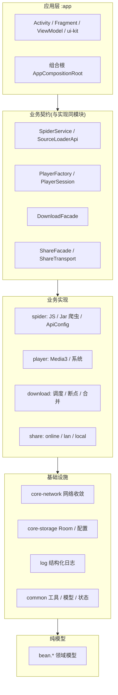

# MBox

> 多源 TVBox 点播 / 直播客户端 —— 基于 [q215613905/TVBoxOS](https://github.com/q215613905/TVBoxOS) 演进，采用 10 模块分层架构。

MBox（原名 TVBoxOS-Mobile / 工程名 TVBoxMobile）是一款 Android 点播 / 直播聚合应用：多源订阅、JS 爬虫、内置下载、HLS 合并、字幕、局域网遥控、主题系统。

| 项 | 说明 |
| --- | --- |
| 应用名 / 包名 | MBox / `com.github.tvbox.osc.mbox` |
| 当前版本 | 3.6.9（versionCode 78） |
| 上游 | [q215613905/TVBoxOS](https://github.com/q215613905/TVBoxOS) |
| 语言 / 内核 | Kotlin + Java；Media3（含 FFmpeg 软解）、系统播放器 |
| 最低系统 | Android 7.0（minSdk 24） |

> 精力有限，未必会及时维护，仅用于学习。

## 功能特性

**内容与播放**
- 多源订阅：远程 JSON 配置，兼容 BOM / 注释 / 图片 + base64 / AES 等非标准套路；支持本地 `.txt` / `.json` 文件导入（SAF `content://` 流）
- 订阅批次分组：一次多仓 / 清单 / 本地包导入产生的多个源自动收进可折叠「手风琴」分组，支持整批更新、重命名、整批删除，组头显示源个数与导入时间
- 点播 / 直播 / 快捷搜索：内置 Media3 与系统播放器，多线路选集、倍速、字幕；历史记录优先用剧集快照起播
- 播放缓存 / 下一集预载：可配边播边缓存与「下一集」预载（仅 Exo 内核 + 直链源）
- 直播源基于 [vbskycn/iptv](https://github.com/vbskycn/iptv)

**下载**
- 默认交给 1DM+；内置下载支持并发调度（1–3）、断点续传、HLS 分段下载及合并（符合条件时封装 MP4）、磁盘空间预检、来源 / 剧名分目录

**体验**
- 自适应卡片（宽 : 高 = 3 : 4，列数随屏宽自适应）
- 主题系统：内置浅色 / 深色与自定义主题，运行时调色板统一供色

**系统能力**
- 局域网服务：默认仅本机回环（订阅 / 本地播放 / 爬虫代理 / m3u8 代理），可开启远程管理与设备配对
- 检查更新：GitHub Releases 检测，Gitee 镜像 / GitHub 加速 / 直连多级回退
- 分享与导入导出：在线、局域网与本地文件传输由 `:share` 模块统一提供
- 崩溃兜底 + 运行日志：业务日志与 logcat 错误流分开查看、筛选、搜索、导出

## 架构总览

目标架构自上而下单向依赖，禁止反向（详见 [doc/ARCHITECTURE.md](doc/ARCHITECTURE.md)）：



## 模块结构

现状 **10 个模块**，依赖只允许自上而下，模块边界由 `./gradlew checkModuleDependencies` 门禁守护（红线见 AGENTS.md）：

| 模块 | 层 | 职责 |
| --- | --- | --- |
| `:app` | 应用层 | 界面（ui / ui-kit / 主题资源）、组合根 `AppCompositionRoot`、启动装配、局域网 HTTP 宿主 |
| `:common` | 基础设施 | 纯模型 `bean.*`、算法工具（AES / MD5 / AdBlocker）、系统状态 `state.*` |
| `:core-network` | 基础设施 | 网络客户端收敛（OkGoHelper / HttpClient / 取流），业务不得自建 OkHttpClient |
| `:core-storage` | 基础设施 | Room / 缓存 / 配置收口，对外只暴露 Repository 与类型安全 Config |
| `:log` | 基础设施 | 结构化日志（LogStore 落 Room）+ Logcat 错误流采集 |
| `:player` | 业务实现 | 播放契约 + 实现同模块：PlayerSession / Media3 / 系统内核 |
| `:spider` | 业务实现 | 爬虫契约 + 实现同模块：QuickJS / JarLoader / ApiConfig / 具体 Spider |
| `:download` | 业务实现 | 只公开 `DownloadFacade`，调度 / 断点 / 归档为内部实现 |
| `:share` | 业务实现 | 契约 + 实现同模块：在线 / 局域网 / 本地文件传输，平台可插拔 |
| `:thirdparty` | 第三方 | TabLayout、CustomActivityOnCrash、QuickJS 源码及本地库（不依赖任何本仓模块） |

## 技术栈

| 组件 | 版本 / 形态 | 用途 |
| --- | --- | --- |
| AndroidX Media3 | 1.11.1（各组件一致） | 播放内核（DASH / HLS / RTSP / RTMP） |
| jellyfin media3-ffmpeg-decoder | 1.9.0+1 | 音频软解（IJK 移除后由 Media3 FFmpeg decoder 提供） |
| Android MediaPlayer | 随系统提供 | 系统播放内核 |
| QuickJS | 内置引擎（2021-03-27） | JS 爬虫引擎 |
| OkHttp | 4.12.0 | 网络请求与媒体取流 |
| Room / DataStore | 2.5.2 / 1.0.0 | 历史、收藏、日志与配置存储 |
| Picasso | 2.71828 | 统一图片加载 |
| Lottie | 6.7.1 | 开屏、加载与界面动画 |

> 旧 ExoPlayer 已迁至 Media3；`EXOmPlayer` 与 `xyz.doikki.videoplayer.exo` 仅为兼容类名，实现只用 `androidx.media3`。
> 原 IJK 内核（内置 FFmpeg ~12MB）已于 2026-10 移除，软解能力改由 Media3 FFmpeg decoder 提供；设置里的类型 1 作废并按类型 2（Media3）回落。

## 构建

### 环境

| 项 | 版本 |
| --- | --- |
| JDK | 17 |
| Gradle | 8.14.2 |
| Android Gradle Plugin | 8.11.1 |
| Kotlin | 2.2.21 |
| compileSdk / targetSdk / minSdk | 36 / 34 / 24 |

`local.properties`（本机 SDK 路径）不入库，首次构建用 Android Studio 打开或自行配置。

Windows：

```bat
set JAVA_HOME=D:\path\to\jdk17
gradlew.bat assembleRelease
```

macOS / Linux：

```bash
export JAVA_HOME=/path/to/jdk17
./gradlew assembleRelease
```

产物路径：`app/build/outputs/apk/release/`。应用名 / 版本号 / 图标统一在 `app/app_config.properties` 维护。

### GitHub Actions 打包

仓库内置 [.github/workflows/build-apk.yml](.github/workflows/build-apk.yml)：

1. 推送代码到 GitHub（`main` / `master` 或 `v*` 标签自动触发；也可 Actions → Build APK → Run workflow 手动触发）
2. 构建完成后在本次运行的 **Artifacts** 区下载 APK

签名与包名说明：

- **包名**为专属 `com.github.tvbox.osc.mbox`，可与设备上其他开源 TVBox 应用**共存安装**。
- **正式签名**为项目专属 `mbox-release.jks`（不入库）；本地读取 `app/keystore.properties`，CI 经 GitHub Secrets 注入。非 tag 构建缺密钥退回 debug 签名；`v*` 正式 tag 缺密钥中止发布。
- ⚠️ 换包名 + 换签名后新包是「全新应用」，请妥善备份 `mbox-release.jks` 与口令。

## 文档导航

- [ARCHITECTURE.md](doc/ARCHITECTURE.md) — 架构总览：分层图、模块依赖图、核心数据流、设计决策
- [项目全景脑图.md](doc/项目全景脑图.md) — 项目全景脑图与模块包结构
- [项目目录结构.md](doc/项目目录结构.md) — 模块 / 包 / 关键类总览
- [项目状态速查.md](doc/项目状态速查.md) — 版本、主题、组件、功能、已知注意速查
- [接口解析.md](doc/接口解析.md) — 订阅解析机制与排查经验
- [直播说明.md](doc/直播说明.md) — 直播源说明
- [Git提交规范.md](doc/Git提交规范.md) — 提交信息格式要求
- 架构演进与改造设计见 `doc/module-refactor-design.md`、`doc/后续改造评估.md` 等

## 致谢

- 上游：[q215613905/TVBoxOS](https://github.com/q215613905/TVBoxOS)
- 推荐使用：[takagen99/Box](https://github.com/takagen99/Box)、[FongMi/TV](https://github.com/FongMi/TV)

## License

见 [LICENSE](LICENSE)
