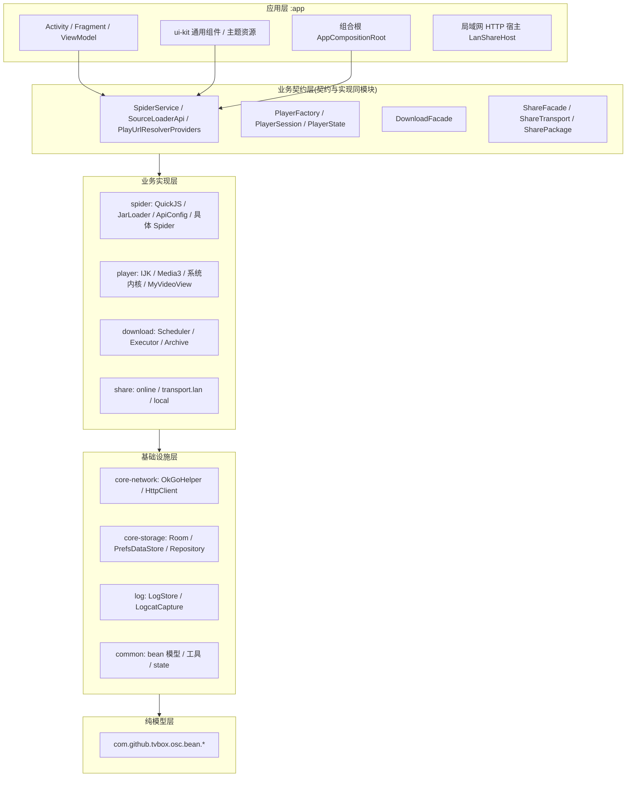
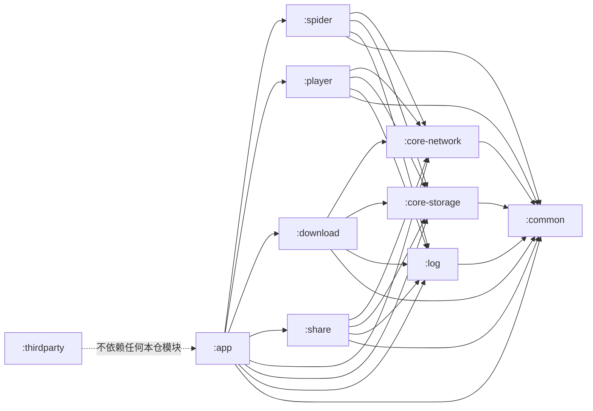
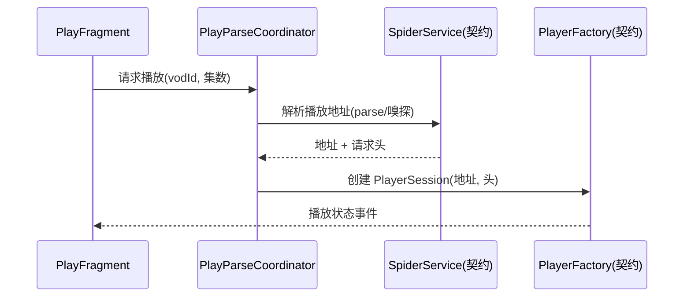
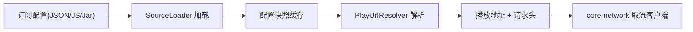
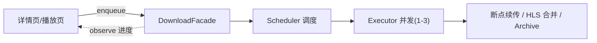
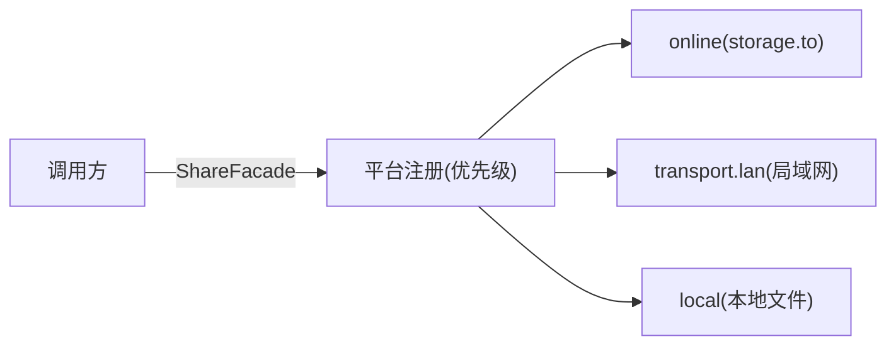

# MBox 项目架构

本文档描述 MBox 的分层架构、模块依赖、核心数据流与关键设计决策。项目规则（红线）的权威落地见仓库根 `AGENTS.md`，本文只做架构视角的导读。

## 一、分层架构

依赖只允许自上而下，禁止反向：



分层要点：

- **业务模块只通过公开契约协作**（接口 / 门面），具体实现放 internal 包。
- **基础模块不得反向依赖业务或 UI**。
- **同一领域模型只定义一次**，跨模块不共享可变对象。
- **后台任务由模块级执行器管理**（如 `HeavyTaskUtil`），页面 / UI 不得自建线程池。
- **UI 组件不读全局配置、不访问业务单例**，状态与事件经属性、接口或 ViewModel 传入。

## 二、模块依赖关系



关键约束（由 `checkModuleDependencies` 门禁强制）：

- `:thirdparty` 是纯第三方归堆，**不依赖任何本仓模块**。
- `:share` 的局域网实现依赖 `:app` 的 `LanShareHost` 桥接，故**` :share` 不得依赖 `:app`**（反向注入）。
- `:app` 的 ui 层禁止 import 下载 / 分享模块的 internal 实现，只允许公开契约。

## 三、模块职责

| 模块 | 层 | 公开契约 / 门面 | 内部实现（不外泄） |
| --- | --- | --- | --- |
| `:app` | 应用层 | 组合根、启动装配、ui-kit | 界面、主题资源、局域网 HTTP 宿主 |
| `:common` | 基础设施 | `bean.*`、工具、`SystemStateMonitor` | — |
| `:core-network` | 基础设施 | `OkGoHelper`、`HttpClient`、`HttpUrls` | OkHttp 装配、SSL 兼容、brotli 拦截器 |
| `:core-storage` | 基础设施 | Repository、类型安全 Config | DAO、Room 迁移、`PrefsDataStore` 底层 |
| `:log` | 基础设施 | `LogStore` | 落库、`LogcatCapture` |
| `:player` | 业务实现 | `PlayerFactory` / `PlayerSession` / `PlayerState` / `PlayerOptions` / `PlayerEvent` | IJK / Media3 / 系统内核、MyVideoView |
| `:spider` | 业务实现 | `SpiderService` / `SourceLoaderApi` / `PlayUrlResolverProviders` | QuickJS / JarLoader / ApiConfig / 具体 Spider |
| `:download` | 业务实现 | `DownloadFacade` | Scheduler / Executor / Archive |
| `:share` | 业务实现 | `ShareFacade` / `ShareTransport` / `ShareLink` / `SharePackage` | online / transport.lan / local |
| `:thirdparty` | 第三方 | — | TabLayout、CustomActivityOnCrash、QuickJS |

## 四、组合根与依赖注入

不强制全面引入 Hilt。先建 app 层组合根 `AppCompositionRoot`，在启动时把具体实现注入契约：

- **静态 `get()` 保留为兼容入口**，新代码一律构造注入接口，ViewModel 经 Factory 取依赖，旧调用迁移后静态入口清零。
- 注入示例：`SourceLoaderApi` → spider 的 `SourceLoaderImpl`；`PlayerFactory` → 具体内核工厂；`DownloadFacade` → 下载模块门面。
- 目的：可替换实现、便于 JVM 单测，不为框架而框架。

## 五、核心数据流

### 5.1 点播起播链路



### 5.2 爬虫取流链路



### 5.3 下载链路



### 5.4 分享 / 导入导出链路



## 六、关键设计决策

| 决策 | 说明 |
| --- | --- |
| 契约与实现同模块 | 合模块后靠源码门禁守边界，不再靠 Gradle 拆模块 |
| Media3 收口 | 旧 ExoPlayer 迁至 Media3 1.4.1；兼容类名保留，禁止重新引入旧 exoplayer 依赖 |
| 数据库「换文件」策略 | schema 变更升 `DB_FILE_VERSION` 换文件名（`tvbox.v<N>.db`），不写 Room Migration；旧代库启动时清理 |
| EventBus 全仓移除 | 跨页 / 模块事件用直调、Facade 订阅接口或明确监听器 |
| 日志单通道 | 业务日志统一 `LogStore`（结构化落 Room），错误流由 `LogcatCapture` 落文件；禁止新增文件级日志通道 |
| 后台任务执行器 | 模块级共享执行器（`HeavyTaskUtil` 等），带取消 / 过期自检语义，禁止页面自建线程池 |
| 新增源码 Kotlin 优先 | 新增 `.kt`；修改既有 `.java` 优先就地转 `.kt`，禁止新建 `.java` |

## 七、工程门禁

```bash
./gradlew checkModuleDependencies
```

门禁校验项（详见根 `build.gradle`）：

- 模块依赖方向（禁止基础模块反向依赖业务 / UI）
- Media3 版本一致、禁止旧 ExoPlayer 依赖
- app 层验收红线：`getCSP()` 直调、Hawk 裸依赖、`DownloadManager.get()`、自建 OkHttpClient、EventBus 残留、爬虫实现直连、具体 Activity 强转、UI 层内核 import、UI 层自建线程池
- app 层禁止 import 下载 / 分享模块内部实现

---

> 本文为架构说明，具体实施请以仓库根 `AGENTS.md` 与 `改进.txt` 为准。
