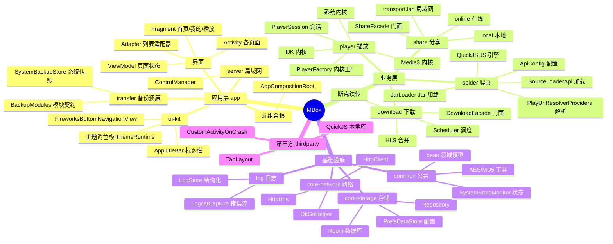

# MBox 项目全景脑图

用一张脑图俯瞰 MBox 的模块、能力与关键类，帮助快速建立全局认知。

## 一、全景脑图



## 二、模块包结构树

```
MBox/
├── app/                        应用层
│   ├── base/                   App、BaseActivity、BaseVbFragment
│   ├── di/                     组合根 AppCompositionRoot
│   ├── player/                 播放器控制器、IjkMediaPlayer、手势识别
│   ├── server/                 局域网 ControlManager
│   ├── theme/                  运行时主题/换肤
│   ├── transfer/               备份还原(BackupModules、SystemBackupStore)
│   ├── ui/                     界面
│   │   ├── activity/  adapter/  dialog/  fragment/
│   │   ├── kit/                 通用组件(标题栏、底部导航、回弹引擎)
│   │   └── state/               页面状态容器
│   ├── util/                   工具(LiveConfig、播放缓存、订阅、预载)
│   └── viewmodel/              SourceViewModel 等
│
├── common/                     纯模型 + 工具 + 系统状态
│   └── com.github.tvbox.osc
│       ├── bean/               领域模型
│       ├── util/               AES/MD5/AdBlocker
│       └── state/              SystemStateMonitor
│
├── core-network/               网络收敛
│   └── OkGoHelper / HttpClient / HttpUrls
│
├── core-storage/               存储收敛
│   ├── cache/                  Room 实体
│   ├── config/                 PrefsDataStore / HawkConfig
│   ├── data/                   AppDataBase / AppDataManager
│   └── repo/                   Repository 门面
│
├── log/                        结构化日志
│   └── LogStore / LogcatCapture
│
├── player/                     播放(契约 + 实现)
│   ├── api/                    契约 PlayerSession/PlayerState/PlayConfig
│   └── 内核 IJK / Media3 / 系统
│
├── spider/                     爬虫(契约 + 实现)
│   ├── spiderapi/              契约 SourcePage/Category/Detail/Search/Play
│   └── QuickJS / JarLoader / ApiConfig / 具体 Spider
│
├── download/                   下载(门面 + 内部实现)
│   ├── DownloadFacade          公开门面
│   └── internal/               Scheduler/Executor/Archive
│
├── share/                      分享(契约 + 实现)
│   ├── 契约 ShareFacade/ShareTransport/SharePackage
│   └── online / transport.lan / local
│
└── thirdparty/                 纯第三方归堆
    ├── TabLayout
    ├── CustomActivityOnCrash
    └── QuickJS(源码 + jniLibs)
```

## 三、依赖方向速记

```
:app / feature
    ↓
业务契约(SpiderService / PlayerFactory / DownloadFacade / ShareFacade)
    ↓
业务实现(spider / player / download / share)
    ↓
基础设施(core-network / core-storage / log / common)
    ↓
纯模型(common 的 bean.*)
```

` :thirdparty` 独立在外，不依赖任何本仓模块。

---

> 更多细节见 [ARCHITECTURE.md](ARCHITECTURE.md) 与 [项目目录结构.md](项目目录结构.md)。
